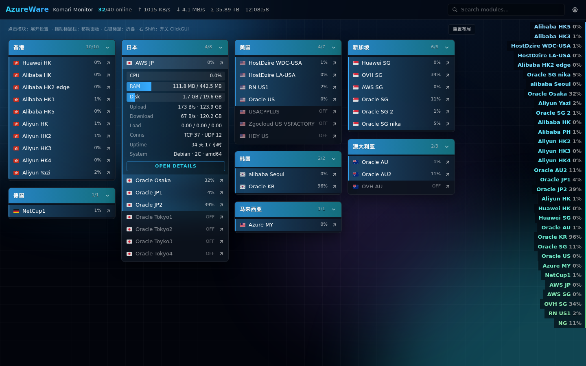

# AzureWare

[Komari](https://github.com/komari-monitor/komari) 监控主题，Minecraft 客户端 ClickGUI 风格。



- **ClickGUI 面板**：每个分组（或地区）一个面板，节点就是“模块”——在线即启用。按住标题栏拖动面板，位置记在浏览器里；右键标题或点箭头折叠。
- **模块设置**：点击模块展开，CPU / 内存 / 硬盘 / 流量以滑条样式显示，另有网速、负载、连接数、运行时间。
- **Visual 面板**：界面自身也是模块——HUD、ArrayList、ClickGUI、Backdrop。左键开关，右键打开设置：ArrayList 的后缀 / 排序 / 配色 / 行数，ClickGUI 的主题色 / 标题栏样式 / 不透明度 / 圆角 / 动效，HUD 各项的显示，背景光晕强度与网格。每位访客的修改记在自己的浏览器里，没改过的项跟随后台的主题设置。
- **ArrayList**：宽屏右上角列出在线节点，进出场从右侧滑入滑出。
- **HUD**：顶部显示在线数、实时上下行、累计流量和时间；按右 Shift 开关 ClickGUI。
- 节点详情页含负载图表、延迟图表和三网回程。

## 安装

在 Komari 后台 → 主题 中上传 [Releases](https://github.com/wugan666/komari-theme-azureware/releases) 里的 zip。

## 主题设置

主题色（azure / cyan / violet / rose / mint）、面板分组方式、是否显示 ArrayList 及其后缀、数据刷新间隔、RPC 连接模式、是否隐藏后台入口。

## 开发

```sh
npm install
npm run build   # 生成 dist 和主题 zip
```

数据层与图表来自 [komari-theme-liquidbounce](https://github.com/wugan666/komari-theme-liquidbounce)（源自 Tokinx 的 komari-theme-emerald，MIT）。
